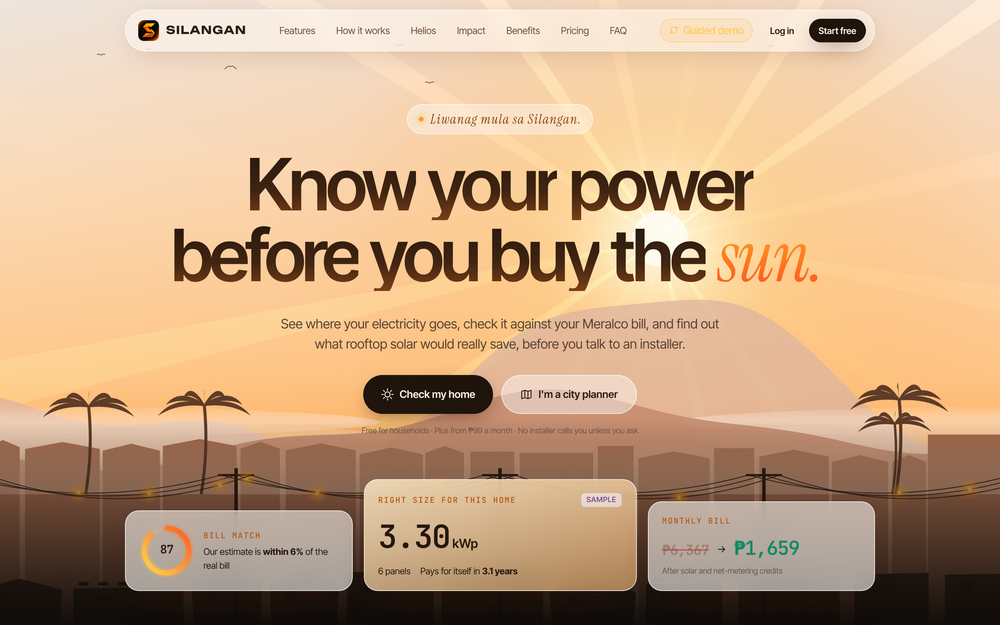
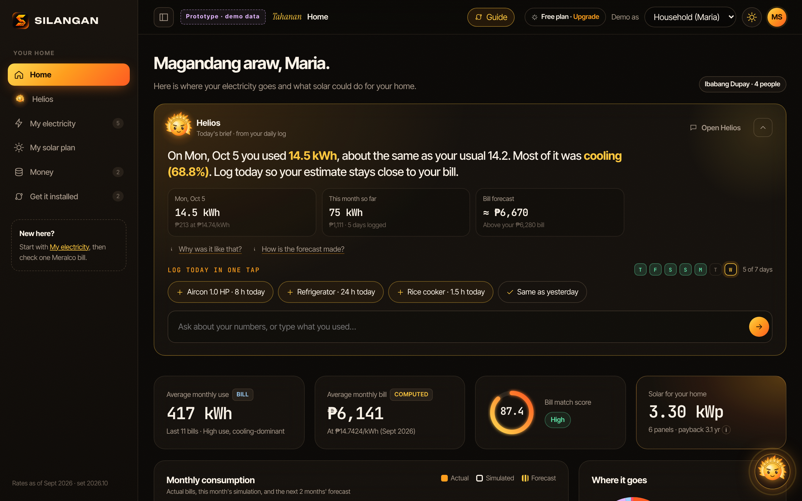
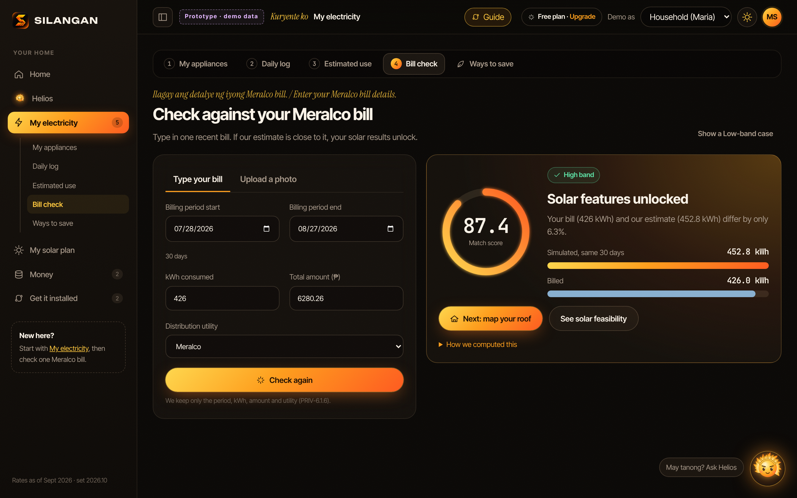
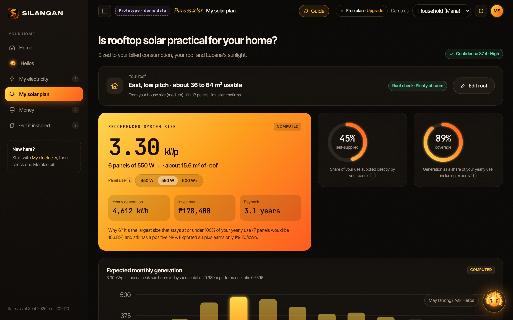
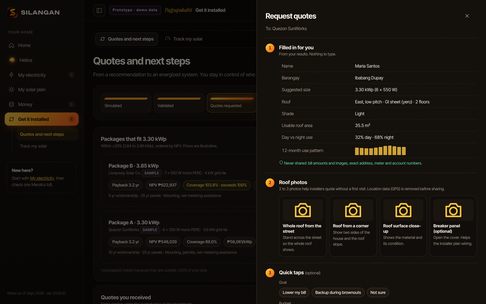
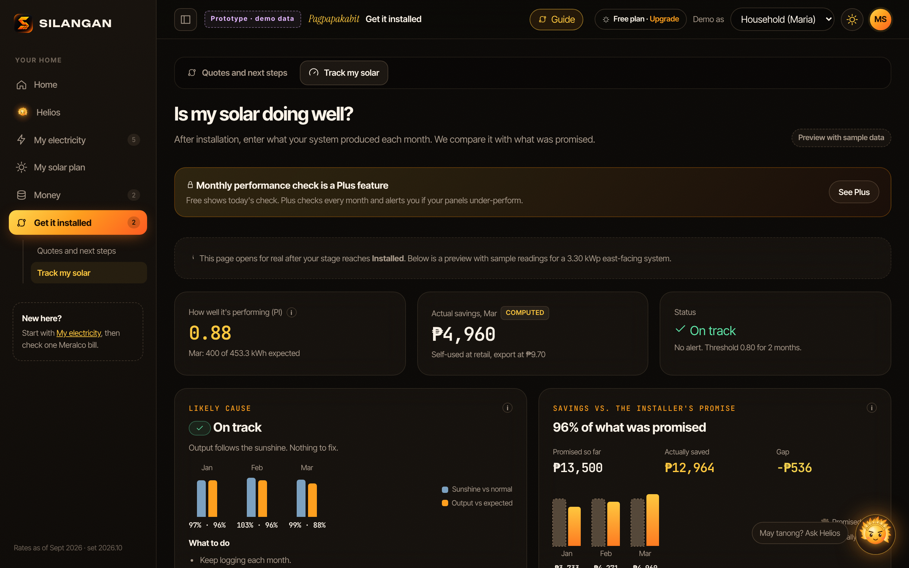
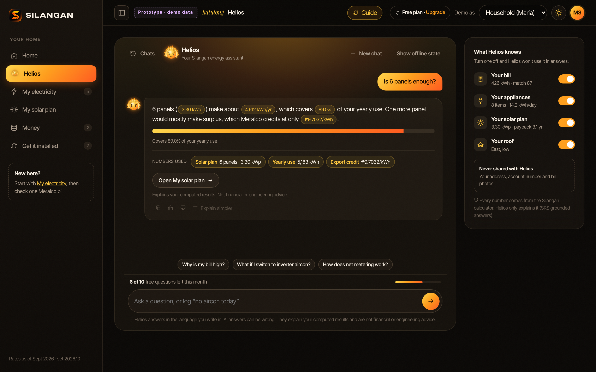
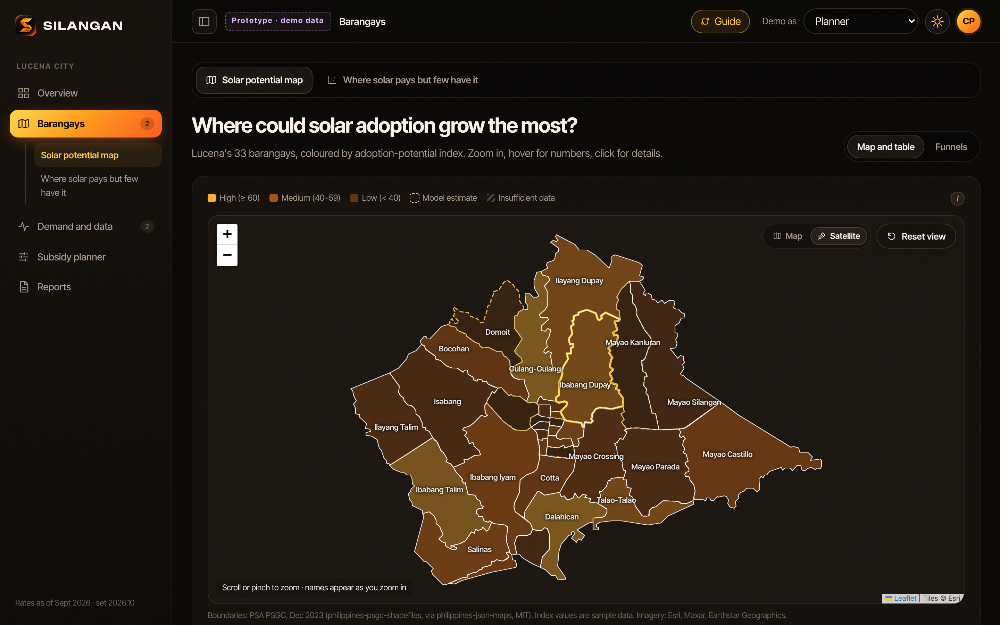
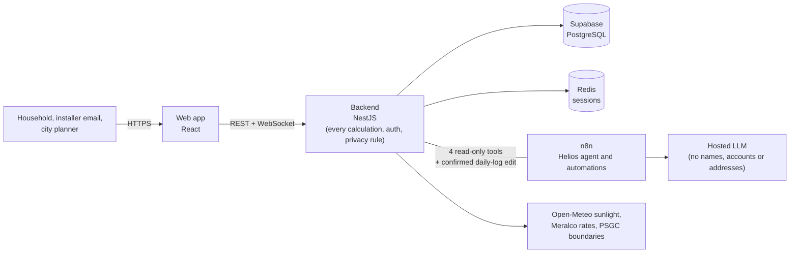

<div align="center">


# SILANGAN

**An AI-Powered Consumption Simulator Bridging Household Solar Feasibility Guidance and Government Demand-Side Energy Planning**

*Know your power before you buy the sun.*

An AI-powered consumption simulator that tells a Filipino family where its electricity goes, checks that against one real Meralco bill, and shows whether rooftop solar pays for its own home. The same answers, anonymized and with consent, show the city where solar pays but few have it.

[](#team-luxus)
[](#traction-and-roadmap)
[](https://jhonlloydval.github.io/Silangan-PSC11/)
[](#sdg-alignment)
[](#license)

**[▶ Try the clickable prototype](https://jhonlloydval.github.io/Silangan-PSC11/)** · Team LUXUS · Manuel S. Enverga University Foundation, Lucena City



</div>

---

## Table of Contents

<details>
<summary>Click to expand</summary>

1. [Overview](#overview)
2. [The Problem](#the-problem)
3. [The Solution](#the-solution)
4. [Prototype Screens](#prototype-screens)
5. [Who It Serves](#who-it-serves)
6. [SDG Alignment](#sdg-alignment)
7. [Pricing](#pricing)
8. [How Silangan Is Different](#how-silangan-is-different)
9. [Traction and Roadmap](#traction-and-roadmap)
10. [Architecture and Tech Stack](#architecture-and-tech-stack)
11. [Privacy by Design](#privacy-by-design)
12. [Repository Contents](#repository-contents)
13. [Run the Prototype](#run-the-prototype)
14. [Team LUXUS](#team-luxus)
15. [References](#references)
16. [License](#license)

</details>

---

## Overview

<div align="center">
  
</div>

<br/>

Philippine households now pay the highest electricity rates in Southeast Asia, yet very few homes have rooftop solar. Families cannot tell whether solar pays for their own house, and most of the advice they get comes from the companies selling the panels.

**SILANGAN**, an AI-powered consumption simulator, answers that in about five minutes, in plain English or Filipino. A family adds its appliances, checks the estimate against one real Meralco bill, answers three roof questions, and sees what rooftop solar would cost, save and pay back on its own roof. **Helios**, the AI assistant, explains every result, while a transparent calculator computes every number. With the household's consent, anonymized results roll up by barangay, so the city can see where solar pays but few have it, and test subsidies before spending.

Silangan is Team LUXUS's entry to the **Philippine Startup Challenge XI (2026)** of the Department of Information and Communications Technology. It is at the **Prototyping** stage: a clickable, non-functioning prototype and a 154-page Software Requirements Specification are complete. The first market is **Lucena City**, Quezon.

---

## The Problem

<div align="center">
  
</div>

<br/>

Electricity is now one of the heaviest household costs in the country. In July 2026 the Department of Energy said Philippine power rates are the most expensive in Southeast Asia, with Meralco at ₱14.48 per kWh in June 2026. In March 2026 the government declared a national energy emergency. At that rate, a Lucena home using 400 kWh a month, typical for a home with one or two aircons, pays about ₱5,800.

<div align="center">
  
  
</div>

<br/>

Rooftop solar is the obvious answer, and the market is growing: the country added 899 MW of solar in 2025, and payback for home rooftop solar has fallen to about three years. Yet only 17,175 users, with about 157 MW, were on net metering as of May 2025, and homes hold only 13% of detected rooftop solar. Research shows cost is not the only barrier: missing or untrusted information also keeps households from adopting solar.

<div align="center">
  
  
</div>

<br/>

Six problems keep families, installers and cities from closing the gap:

| # | Problem | What happens now |
|---|---|---|
| 1 | **Advice comes from sellers** | Most households first hear about solar from an installer who both advises and sells. Families oversize, overpay or give up. |
| 2 | **Bills are hard to read** | Families do not know which appliances drive their bill. Online calculators use generic averages and never check the real bill. |
| 3 | **The path after "yes" is a maze** | Comparing quotes, finding a loan and filing the Meralco net-metering application, with no guide. |
| 4 | **Owners cannot check their systems** | Once the installer leaves, dirt, shading or a failing inverter can cut output for months before anyone notices. |
| 5 | **Installers spend on poor leads** | Site visits to homes whose bill, roof or budget do not fit, and ads that bring the same uncertain inquiries. |
| 6 | **Cities plan without data** | Every city must file an energy efficiency and conservation plan under RA 11285, but has no household-level picture of where solar would pay. |

<div align="center">
  
  
</div>

<br/>

**Why Lucena City.** The capital of Quezon Province has 280,331 residents (2024 POPCEN), 66,905 households (2020 census) in 33 barangays, Meralco rates and about 5.1 peak sun hours a day. It is a realistic, well-defined place to prove the model before scaling to other CALABARZON cities.

---

## The Solution

<div align="center">
  
</div>

<br/>

Silangan guides a household through six steps and serves the city from the same action. A new account starts empty: the household adds its appliances first, presses **Check my bill**, and solar results unlock only after the bill check passes.

<div align="center">
  
</div>

<br/>

| Step | What the household does | What Silangan does |
|---|---|---|
| **1. Add appliances** | Drags in its appliances or starts from a typical Lucena home | Estimates daily use with duty-cycle factors |
| **2. See your use** | Reviews the daily, monthly and yearly view | Rolls the estimate up to a monthly figure with a seasonal range |
| **3. Check your bill** | Types in or photographs one Meralco bill, then presses Check my bill | Gives a bill match score; solar results unlock only when the match is high enough |
| **4. Answer three roof questions** | House size, roof direction and pitch, plus shade | Shows how many panels fit |
| **5. See the savings** | Moves a what-if slider for size, loans and prices | Sizes the system on billed use; shows cost, monthly savings, payback as a range and long-term value |
| **6. Get it installed** | Confirms a phone number with a one-time code and picks up to 3 verified installers | Sends each consented request with a request number, then guides quotes, loans and net metering |

<div align="center">
  
  
  
  
</div>

<br/>

**Helios, the AI that explains.** Helios, named after the Greek god of the sun, answers in the language the household writes in: English, Filipino or Taglish. Each day he opens Home with a short brief: yesterday's use against the usual, the month so far and the expected bill. He suggests ways to save from the household's own appliances and can update the daily log from a plain sentence such as *"no aircon today"*, which the household confirms before it is saved. Questions outside his job are politely declined. Helios never calculates a number itself: every figure comes from the documented calculator, and all calculations keep working when the AI is offline.

**Track my solar, for owners.** Households that already have solar answer one question at the start and go straight to Track my solar. Each month they enter the kWh from the inverter app and the kWh exported on the Meralco bill. Silangan compares actual output with the expected output for that month's real sunlight, gives a status (Good, Watch or Check) with a likely cause, and tracks real savings against the installer's promise.

**The barangay planner, for the city.** With consent, anonymized and confidence-weighted results feed a planner that shows a solar potential score for all 33 barangays, never shows a barangay with fewer than five households, and lets planners test subsidy designs by cost per additional kW.

<div align="center">
  
  
  
</div>

---

## Prototype Screens

All screens use demo data. **[Open the clickable prototype](https://jhonlloydval.github.io/Silangan-PSC11/)** and use *Demo as* in the top bar to switch between a household and a city planner.

| | |
|---|---|
|  |  |
| **Home.** Helios's daily brief, the bill match score and the solar plan at a glance. | **Check your bill.** One Meralco bill confirms the estimate and unlocks solar results. |
|  |  |
| **See the savings.** System size, yearly generation, investment and payback. | **Get it installed.** Phone code, consent, then one request number for up to 3 installers. |
|  |  |
| **Track my solar.** Monthly output checked against what was promised, with the likely cause. | **Helios.** Explains your numbers in the language you write in. |
|  |  |
| **Barangay planner.** Where solar pays but adoption is low, on official PSGC boundaries. | **Landing page.** Free for households, with a sample chat that introduces Helios. |

---

## Who It Serves

<div align="center">
  
</div>

<br/>

| Group | Who they are | What they get |
|---|---|---|
| **Households** (primary users) | Lucena homeowners with a Meralco residential account, especially cooling-heavy homes paying ₱3,000 or more a month | A free, bill-checked solar answer, ways to save, loan options and quotes |
| **Solar installers** | Accredited installers serving Lucena and Quezon Province | Bill-checked, pre-sized quote requests, sent with the household's consent |
| **City Government of Lucena** | City Planning and Development Office and its energy office under RA 11285 | Barangay solar potential, a subsidy tester, monthly reports and data for the energy plan |
| **Barangays and communities** | 33 barangay councils and residents | Targeted information drives where solar pays |
| **Lenders and cooperatives** (later) | Banks, cooperatives and government lenders with solar loans | Households who are already sized and ready |

---

## SDG Alignment

<div align="center">
  
</div>

<br/>

- **SDG 7, Affordable and Clean Energy** (primary): 7.1 affordable energy, 7.2 renewable share, 7.3 energy efficiency through the savings tips.
- **SDG 11, Sustainable Cities and Communities**: 11.b integrated local plans, through barangay data for the city's energy plan.
- **SDG 13, Climate Action**: 13.2 climate measures in local planning, through the barangay planner; 13.3 awareness and capacity, as each household learns what solar and efficiency mean for its own home.

---

## Pricing

Households use the full check for free. Paying never changes rankings, results or the bill check, and sponsored items are always labeled.

| Plan | Price | What it includes |
|---|---|---|
| **Free** (households) | ₱0 | The whole household check, every basic tip, the top 3 AI suggestions, 10 Helios questions a month, 1 home, and a Track my solar check every 3 months for owners |
| **Silangan Plus** (households) | ₱99 a month or ₱799 a year, with a 14-day free trial | Up to 3 homes, all AI savings suggestions and a step-by-step plan, unlimited Helios, log history, a monthly Track my solar check and loan-ready reports |
| **Installer partners** | ₱300 per qualified quote request; listing is free | Counted only when the household's bill is checked and the household sends the request, with at most 3 installers per request. Duplicates, wrong numbers and fake requests are credited on the next monthly invoice |
| **City license** (LGU) | Free for year 1 under a memorandum of agreement, then ₱120,000 a year per city | Barangay planner, subsidy tester, reports, data export and staff training |

---

## How Silangan Is Different

<div align="center">
  
</div>

<br/>

| Alternative | Limitation | Silangan's difference |
|---|---|---|
| Installer quotes and calculators | Advice comes from the seller; sizes are not checked against the bill | Independent; paying installers never changes ranking or results |
| Generic online solar calculators and solar maps | Generic averages, technical terms, no bill check, no next steps | Bill match first, plain English or Filipino, full path to quotes, loans and net metering |
| Asking a general AI chatbot | Numbers can be invented and cannot be traced | Helios explains, but every number comes from a documented calculator |
| City planning without household data | Programs designed blind | Anonymized barangay data and a subsidy tester built for the city's energy plan |

---

## Traction and Roadmap

<div align="center">
  
</div>

<br/>

**Done:** a clickable, non-functioning prototype (27 screens, refined over 7 rounds with faculty feedback), a 154-page Software Requirements Specification (v3.0) with every formula and source, and all 33 Lucena barangays mapped on official PSGC boundaries. Team LUXUS has started problem interviews with Lucena households.

| Period | Milestone |
|---|---|
| Oct to Dec 2026 | Household interviews and prototype tests; installer and City Hall conversations; PSC XI pitching |
| Jan to Mar 2027 | Business and NPC registration; build the first working version from SRS v3.0; expert review of the formulas; calibrate on 10 or more real households; public launch in Lucena |
| Apr to Jun 2027 | Memorandum of agreement with the City Government; pilot in 3 barangays; verify the first 10 installers; open Silangan Plus |
| Jul to Dec 2027 | Citywide rollout to 33 barangays; barangay solar potential report for the city's energy plan; prepare two more CALABARZON cities |

**Pilot targets by December 2027:** 2,000 household checks, including 300 bill-validated profiles from at least 20 barangays; a median gap of 15% or less between estimated and billed use; 10 verified installers and 400 qualified quote requests; a city MOA and a barangay solar potential report; zero personal-data breaches.

---

## Architecture and Tech Stack



| Layer | Technology |
|---|---|
| Frontend | React web application (English and Filipino) |
| Backend | NestJS: all formulas, auth, consent and privacy rules |
| Database | Supabase (PostgreSQL) |
| Sessions | Redis |
| AI | n8n workflow running the Helios agent and automations through a hosted LLM |
| Data | Meralco rates (updated monthly with sources), Open-Meteo sunlight, Global Solar Atlas, PSGC barangay boundaries |
| Hosting | Vercel, Render and Supabase |

The prototype in this repository is a single HTML file with demo data. It shows the planned screens and flows; it does not store data or call any service.

---

## Privacy by Design

- Names, account numbers and addresses never reach the AI provider, installers or the city.
- A quote request goes to installers only after the household confirms its phone number and gives consent.
- The city sees anonymized, confidence-weighted barangay data, and no barangay with fewer than five households is ever shown.
- Only verified installations count in the city's solar uptake data.
- Built to comply with the Data Privacy Act of 2012, with NPC registration when required.

---

## Repository Contents

```
Silangan-PSC11/
├── index.html            # Clickable prototype (single file, demo data); served by GitHub Pages
├── .nojekyll
├── assets/
│   ├── screens/          # Prototype screenshots used in this README
│   ├── pitch-deck/       # PSC XI pitch deck slides
│   └── logo/             # Official logo (dark and light backgrounds) and app mark
├── backend/              # NestJS API (starter scaffold, in development)
│   ├── src/
│   │   ├── app.controller.ts
│   │   ├── app.controller.spec.ts
│   │   ├── app.module.ts
│   │   ├── app.service.ts
│   │   └── main.ts
│   ├── test/
│   │   ├── app.e2e-spec.ts
│   │   └── jest-e2e.json
│   ├── jest.config.ts
│   ├── nest-cli.json
│   ├── package.json
│   ├── tsconfig.json
│   ├── tsconfig.build.json
│   └── README.md
├── LICENSE
└── README.md
```

---

## Run the Prototype

- **Online:** https://jhonlloydval.github.io/Silangan-PSC11/
- **Offline:** download `index.html` and open it in any modern browser. No install or build step is needed.

Tips:

- **Create account** starts an empty home, so you can try every step yourself. **Log in** opens Maria's finished sample home.
- A **guided demo** (full or quick) is offered after you create an account or log in. The **Guide** button in the top bar starts it again at any time.
- Use **Demo as** in the top bar to switch between a household and a city planner, and the sun or moon button to switch light and dark mode.

---

## Team LUXUS

<div align="center">
  
</div>

<br/>

**Manuel S. Enverga University Foundation, Lucena City**

| Member | Role |
|---|---|
| **Jhon Lloyd M. Valencia** | Chief Executive Officer: product, partnerships, city relations |
| **Maurenzio Franck M. Altamarino** | Chief Operating Officer: pilot operations, installer onboarding, finance |
| **Kyle Allen M. Abandia** | Chief Technology Officer: engineering, data, security |
| **Mary Meliza V. Parcon** | Mentor, MSEUF faculty |

<div align="center">
  
</div>

---

## References

- Ateneo de Manila University. (2024, December 13). *Low adoption of solar tech not just due to cost, Ateneo study finds.*
- Department of Energy. (2018). *2015-2017 national grid emission factor (NGEF).*
- Department of the Interior and Local Government. (2020). *Memorandum Circular No. 2020-082* on Republic Act No. 11285.
- Department of the Interior and Local Government. (2025). *Memorandum Circular No. 2025-047.*
- Institute for Climate and Sustainable Cities. (2025, July 15). *Philippines has over 1,800MW potential solar capacity nationwide.*
- Jones, D. (2026, May 28). *Payback period for residential rooftop solar in the Philippines falls to just three years as electricity prices surge.* Ember.
- Jowett, P. (2026, April 20). *Philippines adds 899 MW of solar in 2025.* pv magazine.
- Mahadevan, M., Meeks, R., & Yamano, T. (2023). Reducing information barriers to solar adoption: Experimental evidence from India. *Energy Economics, 120*, 106600.
- Peralta-Malonzo, T. A. (2026, March 24). *Marcos declares state of national energy emergency.* SunStar.
- Philippine Statistics Authority. (2022, May 12). *Household population, number of households, and average household size of the Philippines (2020 CPH).*
- Philippine Statistics Authority. (2025, March 3). *Inventory of housing units in the City of Lucena (2020 Census of Population and Housing).*
- Philippine Statistics Authority. (2025, July 17). *2024 Census of Population (POPCEN) population counts declared official by the President.*
- pv magazine. (2025, September 15). *Philippines updates net-metering rules to ease adoption for 17,000 users.*
- Rai, V., Reeves, D. C., & Margolis, R. (2016). Overcoming barriers and uncertainties in the adoption of residential solar PV. *Renewable Energy, 89*, 498-505.
- Republic Act No. 11285. (2019). *Energy Efficiency and Conservation Act.*
- SolarQuarter. (2025, August 6). *Meralco, ERC, and Quezon City forge partnership to accelerate renewable energy adoption.*
- The Philippine Star. (2026, July 21). *DOE: Philippines power rates now highest in SEA.*
- World Bank Group & Solargis. (n.d.). *Global Solar Atlas: Lucena City* [Data set].

---

## License

Copyright © 2026 Team LUXUS. All rights reserved. See [LICENSE](LICENSE).

The code, designs, screenshots, slides and logo in this repository may be viewed for evaluation of the Philippine Startup Challenge XI entry. They may not be copied, modified, distributed or used commercially without written permission from Team LUXUS.

---

<div align="center">


**SILANGAN** · Team LUXUS · Manuel S. Enverga University Foundation, Lucena City

*Liwanag mula sa Silangan. Know your power before you buy the sun.*

</div>
